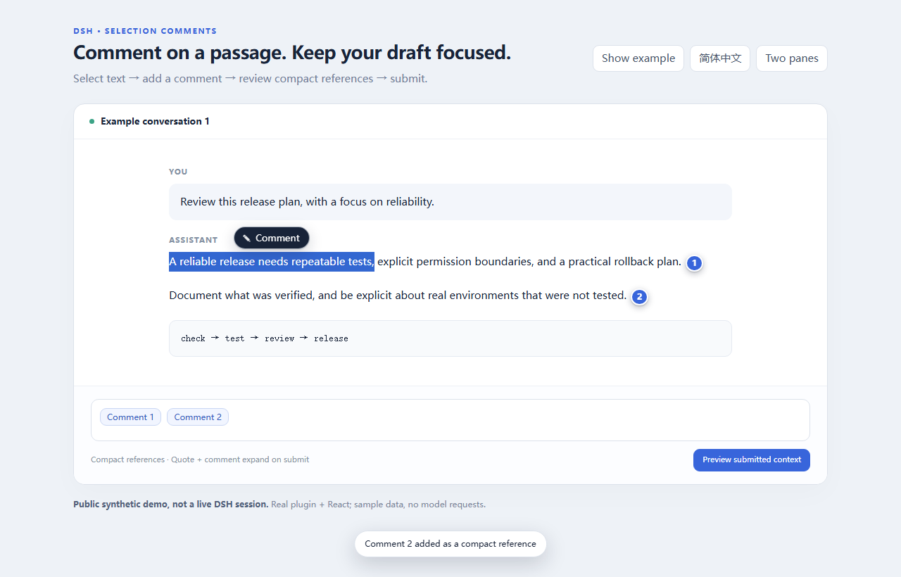
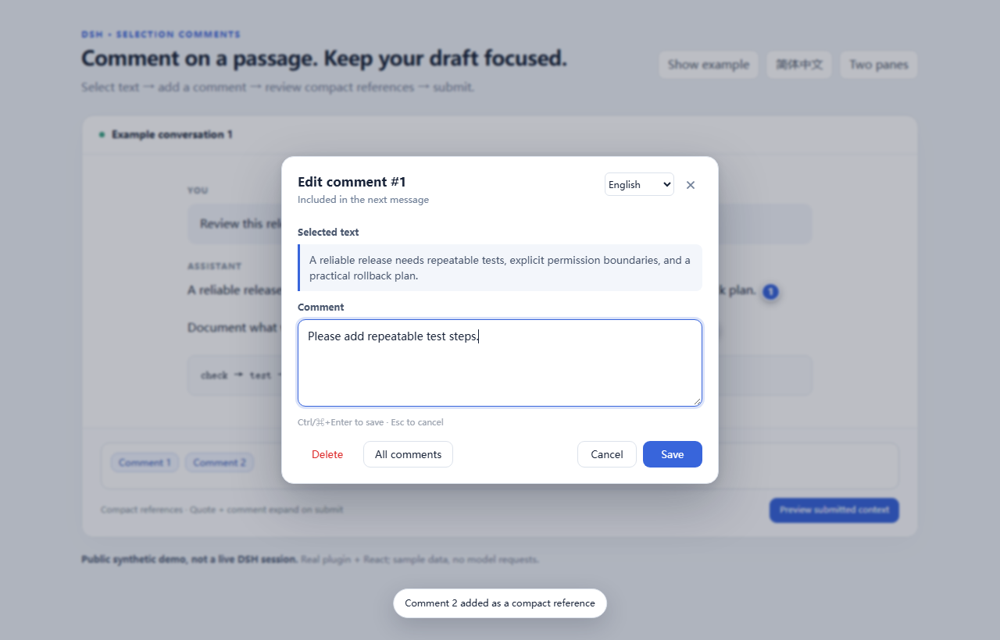
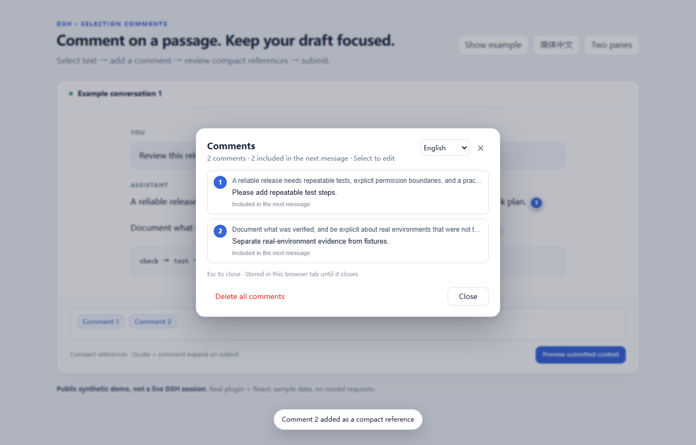

# DSH Selection Comments

[简体中文](README.zh-CN.md)

Comment on conversation passages in DeepSeek Harness Web/Desktop, without filling your draft with copied text.



> Public synthetic demo: real plugin + React with sample transcript/input adapters, not a live DSH session.

## Features

- Select text to add a comment, with a numbered badge anchored beside the passage.
- Keep quote + comment in one compact draft reference; expand both when submitting.
- Edit, delete, or re-add a comment from its badge/reference; review everything in **All comments**.
- Keep the composer uncluttered: no permanent comments toolbar or extra footer counter.

## Install

For DSH Web or Windows Desktop; see the [compatibility matrix](docs/compatibility.md) for the API baseline and tested scope.

```sh
git clone https://github.com/O-OII/dsh-selection-comments.git
cd dsh-selection-comments
dsh plugin --profile desktop add --ignore-scripts .
```

Use the official DSH CLI supplied with your target installation; replace `desktop` with your intended profile. The client bundle is included—no build required.

## Use in four steps

1. Select a passage in the conversation and click **注释 / Comment**.
2. Write your note and choose **Add comment**, or press `Ctrl/⌘+Enter`.
3. Click a numbered badge or draft reference to edit, delete, re-add, or open **All comments**.
4. Submit normally in DSH: references expand to the original quote and your note, not just a number.



## Language

**Simplified Chinese is the default**, even with an English browser or DSH. Choose **English** or **Follow DSH** in the comment dialog's language selector; `Esc` closes the dialog.

## Review your comments

**All comments** shows quotes, notes, and draft status. **Delete all comments** removes this session's comments, draft references, and plugin tab cache.



## Recovery

Comments can recover after refresh in the **same browser tab** via `sessionStorage`; this is not cross-tab/cloud sync or secure erasure—see [privacy and limits](docs/privacy.md).

## Detailed docs

- [Usage, language options & migration](docs/usage.md)
- [Development & reproducible screenshots](docs/development.md)
- [Compatibility & verification](docs/compatibility.md) · [Scope & alternatives](docs/scope.md)
- [Contributing](CONTRIBUTING.md) · [Security reporting](SECURITY.md)

MIT — © 2026 O-OII contributors. See [LICENSE](LICENSE).
