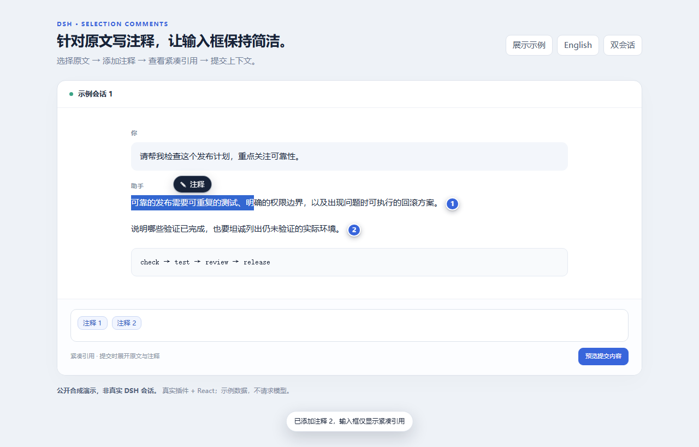
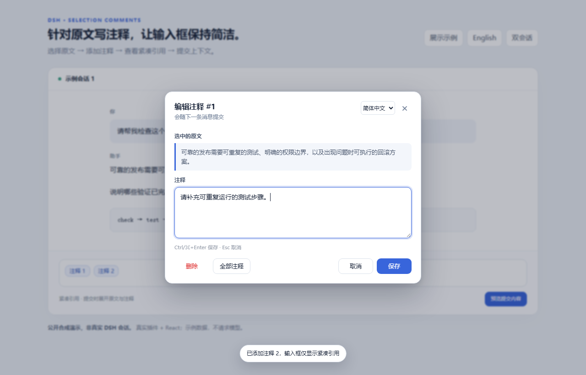
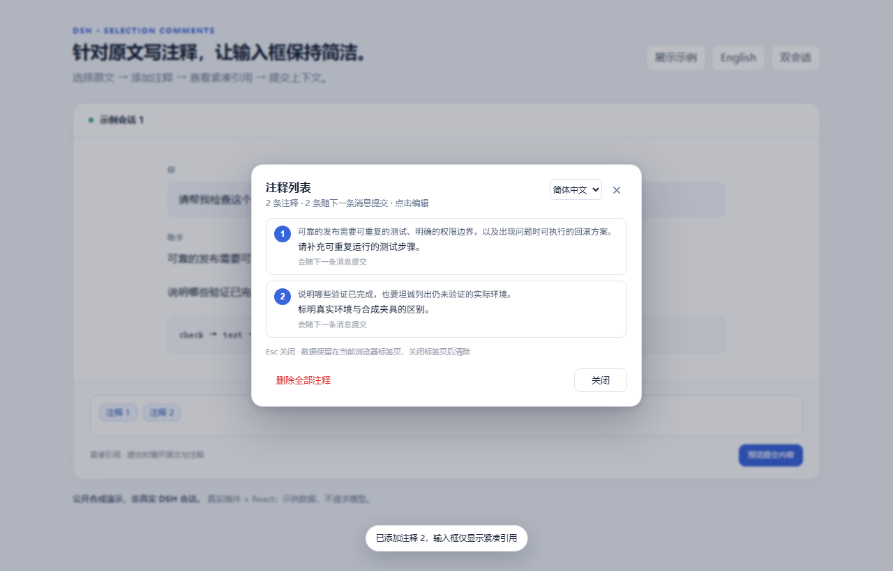

# DSH 选区注释

[English](README.md)

针对 DeepSeek Harness Web/Desktop 会话原文写注释，让输入框保持简洁。



> 公开合成演示：真实插件 + React，正文与输入适配使用示例数据，非真实 DSH 会话。

## 功能

- 选中会话原文添加注释，在原文附近显示编号角标。
- 原文与注释组成一个紧凑引用，提交时才展开完整内容。
- 通过角标或草稿引用编辑、删除、重新加入，在「全部注释」集中查看。
- 保持输入框简洁，不增加常驻注释工具栏或底部计数入口。

## 安装

适用于 DSH Web 或 Windows Desktop；API 基线与实测范围见[兼容性说明](docs/compatibility.md)。

```sh
git clone https://github.com/O-OII/dsh-selection-comments.git
cd dsh-selection-comments
dsh plugin --profile desktop add --ignore-scripts .
```

请使用目标安装所附的官方 DSH CLI，需要其他配置时替换 `desktop`。仓库已包含客户端 bundle，安装无需构建。

## 四步使用

1. 在会话正文选中文字，点击「注释」。
2. 填写内容，点击「添加注释」或按 `Ctrl/⌘+Enter`。
3. 点击编号角标或草稿引用，可编辑、删除、重新加入，或进入「全部注释」。
4. 使用 DSH 正常提交，引用会展开为原文与注释，而不是只发送编号。



## 界面语言

**默认简体中文**，不受浏览器或 DSH 恰好为英文影响；可在注释弹窗的语言选择器切换 **English** 或「跟随 DSH」，按 `Esc` 关闭弹窗。

## 集中管理

「全部注释」展示原文、注释与草稿状态；「删除全部注释」会一并移除该会话的注释、草稿引用和本插件标签页缓存。



## 恢复边界

注释通过 `sessionStorage` 支持**同一浏览器标签页内刷新恢复**，不提供跨标签页或云同步，也不是安全擦除机制，详见[隐私与限制](docs/privacy.md)。

## 详细文档

- [使用、语言选项与迁移](docs/usage.md)
- [开发与截图复现](docs/development.md)
- [兼容性与验证](docs/compatibility.md) · [定位与同类项目](docs/scope.md)
- [贡献指南](CONTRIBUTING.md) · [安全反馈](SECURITY.md)

MIT — © 2026 O-OII contributors。参见 [LICENSE](LICENSE)。
